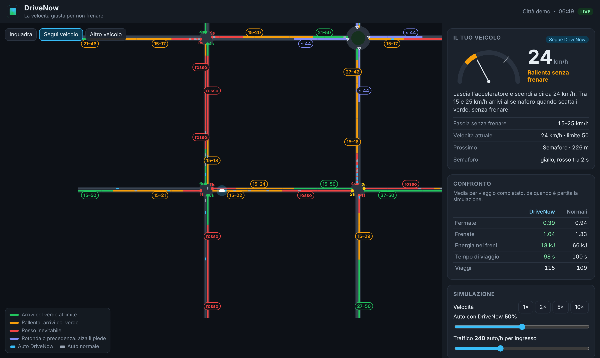

# DriveNow

**La velocità giusta per non frenare.** DriveNow calcola, in tempo reale, per
ogni tratto di strada e per ogni auto, la fascia di velocità (minima e
massima) con cui si arriva al prossimo semaforo **quando è verde**, senza
mai dover frenare. Per rotonde e incroci con precedenza calcola invece la
velocità massima da cui basta alzare il piede per arrivarci alla velocità
giusta.

Esempio: il semaforo diventa verde tra un minuto. Invece di andare a 50 km/h,
fermarsi e ripartire, DriveNow ti dice di scendere, per esempio, a 31 km/h
(fascia 24–36): se la tieni, arrivi alla linea proprio quando scatta il verde.
In letteratura questa tecnica si chiama GLOSA (*Green Light Optimal Speed
Advisory*).



## Come si usa

Serve solo Python 3.9+, senza dipendenze esterne:

```bash
python -m drivenow.server
```

Poi apri <http://localhost:8000>. La mappa si aggiorna 5 volte al secondo:

- **le strade sono colorate** con la fascia di velocità valida da quel punto:
  verde vuol dire che al limite arrivi col verde, arancione che devi
  rallentare (l'etichetta, per esempio `18–35`, dice di quanto), rosso che il
  rosso è inevitabile, viola che c'è una rotonda o una precedenza;
- **i semafori** mostrano il colore e i secondi al prossimo cambio;
- **il pannello "Il tuo veicolo"** segue un'auto e le dà il consiglio come lo
  vedrebbe un guidatore: velocità consigliata, fascia, prossimo incrocio,
  conto alla rovescia del semaforo;
- **il confronto** misura, sui viaggi completati, fermate, frenate, energia
  buttata nei freni e tempo di viaggio delle auto che seguono il consiglio
  rispetto a quelle che non lo seguono.

Clic su un'auto per seguirla, rotella per lo zoom, trascina per spostarti.

### Con le reti di Traffc_light_control

DriveNow è nato dalla repository Traffc_light_control (ora dismessa): ne usa
le reti SUMO a griglia 1×1, 2×2, 3×3 e 4×4 (`.net.xml`, copiate in `data/sumo/`) e può far
girare il traffico direttamente in SUMO tramite TraCI.

```bash
python -m drivenow.server --net data/sumo/3_3_intersections.net.xml          # simulatore interno
```

```bash
pip install eclipse-sumo traci
python -m drivenow.server --sumo --net data/sumo/3_3_intersections.net.xml   # traffico in SUMO
```

Con `--sumo --gui` si apre anche `sumo-gui`.

Nella repository base i semafori sono comandati da un agente (PPO o regole),
che decide passo per passo: per questo nel file di rete le fasi durano 100000
secondi, e i tempi futuri non si possono conoscere. DriveNow installa quindi
in SUMO il ciclo fisso del `CycleRuleSet` della repository (20 s di verde per
direzione più 3 s di giallo), così la previsione e ciò che fa SUMO sono la
stessa cosa. Un test lo verifica confrontando ogni passo.

### Opzioni

| Opzione | Default | Cosa fa |
|---|---|---|
| `--net FILE` | città demo | rete SUMO da caricare |
| `--sumo` | no | fa girare il traffico in SUMO |
| `--speed N` | 1 | velocità della simulazione (1 = tempo reale) |
| `--penetration P` | 0.5 | quota di auto che seguono DriveNow (0–1) |
| `--demand N` | 240 | auto/ora per ogni strada di ingresso |
| `--port N` | 8000 | porta del server |

Velocità, quota DriveNow e traffico si cambiano anche dal pannello.

## Come funziona il calcolo

Tutto il calcolo è in `drivenow/glosa.py`, separato da mappa e simulazione.

1. **Finestre di verde.** Dal piano semaforico (`drivenow/signals.py`) si
   ricavano gli intervalli di verde futuri per la corsia dell'auto.
2. **Margini e traffico.** Ogni finestra si restringe: si arriva almeno 1 s
   dopo lo scatto del verde e almeno 1 s prima del giallo. Se c'è coda, il
   verde "utile" parte dopo 2 s più 2 s per ogni auto in coda. Se davanti c'è
   un'auto in movimento, non si può arrivare prima di lei più 1,5 s. Il giallo
   non conta mai come verde: DriveNow non consiglia di passare col giallo.
3. **Modello senza freno.** Per cambiare velocità il guidatore non frena: se
   deve rallentare alza il piede e l'auto decelera da sola (circa 0,7 m/s²);
   se deve accelerare lo fa a 1,3 m/s². Il tempo di arrivo alla linea tiene
   conto di questa transizione.
4. **Fascia.** Si cercano tutte le velocità tra 15 km/h e il limite che
   portano alla linea dentro una finestra di verde. Gli estremi della fascia si
   trovano per bisezione, perché il tempo d'arrivo cala sempre al crescere
   della velocità.
5. **Velocità consigliata.** Dentro la fascia si punta ad arrivare 1,5 s dopo
   l'inizio del verde utile. Puntare a un orario, e non a un punto della
   fascia, rende il consiglio stabile: chi lo segue riceve lo stesso numero
   all'aggiornamento successivo.
6. **Rotonde e precedenze.** La velocità massima è quella da cui, alzando il
   piede, si arriva all'ingresso a 25 km/h (20 km/h per una precedenza):
   `v = √(v_ingresso² + 2·0,7·d)`.
7. **Varchi nella strada principale.** A una precedenza DriveNow guarda le
   auto sulla strada principale, fino a 150 m per lato, e calcola quando
   l'incrocio è libero: da 3,5 s prima a 1,5 s dopo il passaggio di ogni auto
   è occupato. Se alla solita velocità si arriva in un varco, il consiglio
   resta il tetto del punto 6. Altrimenti è la fascia di velocità che porta
   all'incrocio nel varco successivo, come per un verde; se nessuna velocità
   ragionevole ci arriva, si lascia scorrere l'auto fino alla linea. Chi gira
   a destra dà precedenza solo a chi va nella stessa direzione; chi gira a
   sinistra lasciando la strada principale dà precedenza al traffico che
   arriva di fronte. Se un'auto segue a meno di 30 m, niente rallentamento in
   anticipo: la si costringerebbe a frenare. Serve sapere dove sono le auto
   sulla strada principale: un sensore all'incrocio o le auto stesse che
   condividono la posizione.

Se nessuna velocità prende il verde, il consiglio è di lasciar scorrere l'auto
fino alla linea, così si arriva piano e senza frenate brusche.

La mappa (`Advisor.speed_field`) usa lo stesso calcolo per un'auto che sta già
viaggiando a velocità costante, ogni 20 m di ogni tratto che porta a un
semaforo, a una rotonda o a una precedenza.

## Risultati in simulazione

Traffico simulato con il 100% delle auto DriveNow contro lo 0%, valori medi per
viaggio:

| Rete | Fermate | Frenate | Energia nei freni | Tempo di viaggio |
|---|---|---|---|---|
| Città demo (simulatore interno, 3 semi) | 1,33 → 0,52 | 2,49 → 1,31 | 96 → 23 kJ | 107 → 112 s (+4%) |
| Griglia 2×2 della repo base (SUMO, 30 min) | 1,35 → 0,16 | 2,60 → 0,73 | 146 → 20 kJ | 92 → 95 s (+3%) |
| Griglia 3×3 della repo base (SUMO, 30 min) | 2,23 → 0,23 | 4,59 → 1,11 | 230 → 28 kJ | 133 → 136 s (+2%) |

Il piccolo aumento del tempo di viaggio ha due cause. Chi segue DriveNow
rallenta prima delle rotonde invece di frenare all'ultimo. E non sfrutta mai
il giallo, mentre in simulazione i guidatori normali lo fanno.

Nella città demo restano più fermate che in SUMO perché ci sono una rotonda e
una precedenza con traffico vero, dove a volte fermarsi è inevitabile.

Per default si guarda solo il prossimo semaforo. Il calcolo sa concatenarne
più d'uno (`max_signals`) per cercare un'onda verde. In simulazione però
costava circa 3 s a viaggio senza togliere fermate, perché le code ai
semafori successivi non sono prevedibili.

## Dati reali: Amburgo

Per provare DriveNow su dati veri ci sono due scenari reali di Amburgo,
entrambi nell'ora di punta di giovedì 14 settembre 2023, dalle 17 alle 18:

- **Gärtnerstraße** (default): Osterstraße → Gärtnerstraße → Breitenfelder
  Straße, circa 1,8 km. Quasi tutti i semafori del tratto hanno dati reali.
- **Willy-Brandt-Straße / Ludwig-Erhard-Straße**, nel centro (circa 1,9 km,
  9 impianti semaforici con dati, molti altri senza).

```bash
pip install eclipse-sumo traci sumolib
python -m drivenow.server --hamburg                 # Gärtnerstraße
python -m drivenow.server --hamburg willy-brandt
```

Da dove vengono i dati:

- **Semafori: reali.** Sono gli stati registrati secondo per secondo dalla
  città di Amburgo, nella raccolta pubblicata dalla TU Dresden. Ogni passo,
  SUMO mostra lo stato registrato in quel momento.
- **Mappa: reale.** Viene da OpenStreetMap, convertita in rete SUMO. I
  semafori stanno dove li ha Amburgo; dove Amburgo non fornisce dati restano
  quelli di OpenStreetMap, con un programma fisso stimato da SUMO.
- **Traffico: in parte reale.** Dove esistono, i volumi sono tarati sui
  conteggi dei rilevatori di Amburgo in quell'ora. Dove mancano rilevatori
  (l'asse principale di Willy-Brandt-Straße, alcuni tratti di Gärtnerstraße)
  il volume è un'ipotesi, scritta in `scenario.json`.

Dettagli, fonti e licenze sono in [`data/hamburg/README.md`](data/hamburg/README.md).
Tutto si ricostruisce con
`python tools/hamburg_build.py --scenario gaertnerstrasse --cache CARTELLA`
(o `--scenario willy-brandt`).

### Previsione dei semafori

Questi semafori hanno un ciclo fisso (45–90 s a seconda dell'impianto e
dell'ora), ma la durata del verde varia con il traffico. DriveNow non
guarda il futuro registrato. Per ogni segnale impara dagli ultimi 20 cicli
la probabilità di verde in ogni secondo del ciclo, e considera verde un
secondo futuro solo se quella probabilità arriva all'80%
(`drivenow/hamburg/signals.py`).

Il ciclo viene dal dato "secondo del ciclo" che ogni impianto pubblica. Quel
dato però ha buchi lunghi nella registrazione: a Gärtnerstraße manca per
quasi tutta l'ora di prova. In quel caso il ciclo si ricava dagli inizi del
verde del semaforo stesso. Se non c'è un ciclo regolare (una strada
principale che diventa rossa solo a richiesta), la previsione è la quota di
tempo in cui il semaforo è stato verde nell'ultima mezz'ora. Se non si sa
proprio nulla, DriveNow non dà consigli per quel semaforo, invece di
considerarlo sempre rosso.

Ecco quanto la previsione indovina lo stato reale nell'ora di prova
(Willy-Brandt-Straße):

| Fra | 5 s | 15 s | 30 s | 60 s | 90 s |
|---|---|---|---|---|---|
| Stato corretto | 93,4% | 92,5% | 92,1% | 92,2% | 91,7% |
| Previsto verde, era rosso | 1,0% | 1,1% | 0,5% | 0,5% | 0,5% |
| Verde reale non previsto | 5,6% | 6,4% | 7,4% | 7,4% | 7,8% |

L'errore pericoloso, cioè promettere un verde che non arriva, è raro. Quello
più frequente è prudente: un verde reale che il modello non dà per certo.

### Effetto in simulazione

Ogni esperimento dura un'ora; il confronto è tra 0% e 100% di auto DriveNow.
L'"oracolo" usa il futuro registrato al posto della previsione e indica il
massimo ottenibile con una previsione perfetta.

| Traffico | Consiglio | Fermate | Frenate | Energia nei freni | Tempo |
|---|---|---|---|---|---|
| Ora di punta | nessuno | 3,44 | 12,15 | 387 kJ | 329 s |
| | previsione | 3,21 | 10,63 | 308 kJ | 336 s |
| | oracolo | 3,15 | 10,78 | 317 kJ | 327 s |
| Metà traffico | nessuno | 2,93 | 10,54 | 398 kJ | 254 s |
| | previsione | 2,90 | 10,13 | 326 kJ | 259 s |
| | oracolo | 2,89 | 10,13 | 328 kJ | 259 s |

L'energia buttata nei freni cala del 18–20% e le frenate dal 4 al 13%. Le
fermate, invece, quasi non cambiano. Contando dove si fermano le auto (metà
traffico, primi 25 minuti), il motivo si vede:

| Dove avviene la fermata | Quota |
|---|---|
| Semafori presi da OpenStreetMap, senza dati reali e quindi senza consiglio | 53% |
| Incroci con precedenza | 24% |
| I 9 impianti con dati reali di Amburgo | 23% |

Le fermate alle precedenze sono quasi tutte inevitabili: l'asse principale
ha tanto traffico che varchi di 5 secondi non se ne aprono quasi mai, e il
consiglio giusto resta lasciar scorrere l'auto fino alla linea. Il consiglio
sui varchi (punto 7) aiuta invece chi gira a sinistra lasciando l'asse. Media
di due simulazioni, ora di punta, previsione:

| Precedenze | Fermate | Frenate | Energia nei freni | Tempo |
|---|---|---|---|---|
| Solo tetto di velocità | 3,21 | 10,67 | 309 kJ | 331 s |
| Varchi | 3,23 | 10,48 | 283 kJ | 340 s |
| Varchi, ma non con un'auto vicina dietro (default) | 3,22 | 10,59 | 288 kJ | 333 s |

Puntare ai varchi toglie il 7–8% dell'energia nei freni. Senza la regola
sull'auto che segue costa però il 2,6% di tempo, perché chi rallenta per
girare a sinistra rallenta anche chi gli sta dietro; con la regola il costo
scende allo 0,7%. Nella città demo, dove la precedenza ha meno traffico, i
varchi tolgono l'11–13% dell'energia nei freni senza costi di tempo.

Sui 9 impianti con dati reali, con l'oracolo, le fermate calano del 10%. Il collo di
bottiglia quindi non è la previsione, che è quasi buona quanto l'oracolo, ma
la **copertura**: dei 35 impianti semaforici della zona simulata, solo 9
hanno dati reali. Per questo c'è il secondo scenario.

### Semafori senza dati: imparati dalle auto

Molti semafori non pubblicano nulla. Le auto DriveNow però li vedono ogni
giorno, e da quello che fanno si ricava il loro orario
(`drivenow/probe.py`):

- un'auto ferma alla linea che riparte: il verde è appena cominciato;
- un'auto che passa la linea: è verde;
- un'auto ferma alla linea: è rosso.

Dagli inizi del verde si trova la durata del ciclo (quella per cui cadono
tutti nello stesso punto del ciclo); la fine del verde sta tra gli ultimi
passaggi e le prime auto ferme al rosso. Se le osservazioni non stanno in un
ciclo fisso, il semaforo resta senza previsione.

Willy-Brandt-Straße, dopo 40 minuti di ora di punta con il 100% di auto
DriveNow: 48 dei 98 accessi semaforici senza dati di Amburgo sono stati
imparati (gli altri hanno visto troppo poche auto). Su questi la previsione è
giusta il 93,5% delle volte, da 0 a 60 s in avanti: un verde promesso che non
arriva nel 2,7% dei casi, un verde reale non previsto nel 3,8%. È quanto la
previsione costruita sui dati ufficiali.

Effetto in simulazione, un'ora, previsione e consiglio sulle precedenze
attivi in entrambi i casi:

| Scenario | Semafori senza dati | Fermate | Frenate | Energia nei freni | Tempo |
|---|---|---|---|---|---|
| Willy-Brandt-Straße (media di 2 semi) | nessun consiglio | 3,22 | 10,59 | 288 kJ | 333 s |
| | imparati dalle auto | 3,15 | 10,11 | 249 kJ | 349 s |
| Gärtnerstraße (metà traffico) | nessun consiglio | 1,03 | 2,87 | 118 kJ | 184 s |
| | imparati dalle auto | 0,97 | 2,80 | 107 kJ | 184 s |

L'energia buttata nei freni cala del 14% a Willy-Brandt-Straße (−21% per chi
percorre l'asse) e del 9% a Gärtnerstraße; le fermate del 2–6%. A
Willy-Brandt-Straße il tempo di viaggio sale del 5%: la previsione è
prudente e chi la segue a volte rallenta per un verde che sarebbe durato.
La misura è anche pessimista: le auto partono senza sapere nulla e nei primi
10–15 minuti nessun semaforo è ancora imparato, mentre in un servizio reale
l'orario imparato resta da un giorno all'altro.

Rispetto a nessun consiglio (tabella più sopra), a Willy-Brandt-Straße
DriveNow ora toglie l'8% delle fermate e il 36% dell'energia nei freni, per
il 6% di tempo in più.

### Code e incroci "precedenza a destra"

Due cause di fermata alle precedenze, sull'asse principale:

- **La coda del semaforo successivo che arriva fino all'incrocio.** La coda
  ora si conta lungo tutto il percorso fino al semaforo, non solo sul suo
  tratto d'accesso. E se davanti c'è una coda ferma senza un semaforo noto
  dietro (un semaforo senza dati, un incrocio intasato), si lascia scorrere
  l'auto fino alla fine della coda invece di frenare lì.
- **Gli incroci senza strada principale.** OpenStreetMap li segna come
  "precedenza a destra" (35 a Willy-Brandt-Straße); prima erano trattati
  come se nessuno dovesse dare precedenza. Ora ogni accesso dà precedenza a
  chi arriva da destra, con lo stesso consiglio sui varchi.

| Willy-Brandt-Straße | Fermate | Frenate | Energia nei freni | Tempo | Viaggi finiti |
|---|---|---|---|---|---|
| Prima (media di 2 semi) | 3,15 | 10,11 | 249 kJ | 349 s | 2.931 |
| Con code e precedenza a destra | 3,04 | 9,54 | 221 kJ | 337 s | 2.877 |

L'energia nei freni cala di un altro 11%, le fermate del 4% e anche il
tempo di viaggio scende del 4%. Le due parti contano in modo diverso: la
precedenza a destra da sola accorcia i tempi (−2,5%) senza cambiare
l'energia; il conteggio delle code toglie il 12% dell'energia. Un limite: le
auto finite nell'ora sono il 2% in meno, quindi qualche auto lenta in più
resta in rete alla fine e il tempo medio è un po' ottimista. A Gärtnerstraße,
che ha poche code di questo tipo, l'energia cala del 5% e il resto non
cambia.

Il modello non conosce le corsie: un'auto ferma nella corsia di svolta può
far rallentare chi va dritto. Nonostante questo il bilancio resta positivo.

Riassunto, Willy-Brandt-Straße all'ora di punta, 0% contro 100% di auto
DriveNow: fermate 3,44 → 3,04 (−12%), energia nei freni 387 → 221 kJ (−43%),
tempo di viaggio 329 → 337 s (+2%).

### Gärtnerstraße: un corridoio coperto

Qui 9 degli 11 impianti semaforici della zona hanno dati reali, e così il
53% dei link semaforici di SUMO (gli altri sono soprattutto corsie di svolta
e strade laterali senza dati). La rete comprende solo una fascia di 80 m
attorno al corridoio, quindi le strade laterali sono brevi.

La previsione, misurata sui segnali usati dalla simulazione:

| Fra | 5 s | 15 s | 30 s | 60 s | 90 s |
|---|---|---|---|---|---|
| Stato corretto | 96,8% | 96,5% | 96,3% | 96,0% | 95,9% |
| Previsto verde, era rosso | 1,5% | 1,7% | 1,8% | 2,0% | 2,0% |
| Verde reale non previsto | 1,7% | 1,8% | 1,9% | 1,9% | 2,2% |

Metà del traffico stimato (a pieno traffico la rete ritagliata si
intasa), un'ora, 0% contro 100% di auto DriveNow. "Asse" sono i viaggi che
percorrono il corridoio per almeno il 60% della strada (circa 360 viaggi);
"tutti" sono tutti i viaggi (circa 610):

| Viaggi | Consiglio | Fermate | Frenate | Energia nei freni | Tempo |
|---|---|---|---|---|---|
| Asse | nessuno | 0,98 | 2,71 | 136 kJ | 160 s |
| | previsione | 0,94 | 2,48 | 100 kJ | 169 s |
| | oracolo | 0,91 | 2,46 | 101 kJ | 164 s |
| Tutti | nessuno | 1,06 | 3,15 | 159 kJ | 189 s |
| | previsione | 1,02 | 2,86 | 118 kJ | 178 s |
| | oracolo | 1,02 | 2,83 | 117 kJ | 180 s |

Con la copertura quasi completa l'energia buttata nei freni cala di un
quarto (−26%), le frenate dell'8–9% e le fermate del 4–7%. Sull'asse la
previsione costa 9 s a viaggio (+5,5%) contro i 3,5 s dell'oracolo: sono i
verdi che il modello non dà per certi, per cui l'auto rallenta per niente.
Sull'insieme dei viaggi il tempo invece cala, perché si formano meno code.

È una sola simulazione per caso, con un solo seme casuale: le differenze
piccole (le fermate, il tempo) vanno prese come indicazioni, non come
misure precise.

## Dal simulatore alla strada vera

Il motore di calcolo non sa da dove arrivano i dati. La simulazione interna e
il ponte SUMO gli passano la stessa cosa: piani semaforici, posizioni e
velocità dei veicoli. Per usarlo su strade reali bisogna sostituire queste due
fonti:

- **Tempi dei semafori.** Lo standard è il messaggio SPaT/MAP (ETSI
  SPATEM/MAPEM in Europa, SAE J2735 negli USA). Lo trasmettono le unità C-ITS
  a bordo strada e alcune centrali del traffico cittadine. Dove non c'è, i
  tempi si possono stimare dai passaggi osservati, e la stima va mostrata con
  la sua incertezza. Con semafori adattivi (come l'agente PPO della
  repository base) servono la previsione della centrale o un modello
  predittivo.
- **Posizione e traffico.** GPS dello smartphone o dell'auto per la propria
  posizione, dati di traffico (o i veicoli connessi) per code e veicolo
  davanti.
- **Mappa.** La geometria va presa da OpenStreetMap o dai MAPEM, al posto
  della rete SUMO.

## Struttura

```
drivenow/
  glosa.py        calcolo: tempi d'arrivo, fasce, consiglio (nessuna dipendenza)
  signals.py      piani semaforici a tempo fisso e finestre di verde
  network.py      rete: città demo e caricatore .net.xml di SUMO
  advisor.py      unisce rete, traffico e calcolo: consiglio per veicolo e campo per la mappa
  simulation.py   simulatore interno (IDM, semafori, rotonda, precedenza)
  sumo_world.py   ponte TraCI con SUMO
  hamburg/        dati reali di Amburgo: storico e previsione dei semafori, mondo SUMO
  server.py       server della mappa (HTTP + Server-Sent Events, solo libreria standard)
web/              mappa: index.html, style.css, app.js
data/sumo/        reti a griglia 1×1–4×4 (dalla vecchia Traffc_light_control)
data/hamburg/     scenario reale di Amburgo (rete, semafori registrati, traffico)
tools/            costruzione dello scenario di Amburgo, esperimenti, registrazione delle pagine
tests/            pytest (i test SUMO si saltano se SUMO non è installato)
```

Test:

```bash
pip install pytest
python -m pytest
```

## Test dell’interfaccia

I controlli browser automatici verificano la demo su desktop e telefono,
oltre ai test Python del motore. Comandi e procedura facoltativa con
[vibetest-use](https://github.com/browser-use/vibetest-use) sono nella
[guida ai test browser](docs/browser-testing.md).

## Istruzioni per gli agenti di sviluppo

La repo include le procedure di sviluppo di **agent-skills**, collegate da
[`AGENTS.md`](AGENTS.md) e adattate al flusso di lavoro DriveNow tramite le
regole del progetto. Vedi la [guida](docs/agent-skills.md).

## Esperimenti con LibSignal

Il [ponte SUMO per LibSignal](docs/libsignal.md) legge i veicoli dal suo mondo
simulato e può applicare i consigli DriveNow mentre LibSignal controlla i
semafori. Include una verifica eseguibile con il sorgente upstream reale;
le finestre di verde devono essere fornite esplicitamente dal controllore.

## Confronto previsioni con Darts

L'[esperimento offline Darts](docs/darts.md) confronta NaiveSeasonal con il
previsore DriveNow sui dati di Amburgo, usando solo il passato per prevedere.
Include un rapporto riproducibile e non modifica automaticamente il modello
usato per i consigli alle auto.

## Sviluppo in container isolati

[Container-use](docs/container-use.md) dispone di configurazione Python per
DriveNow, installer verificato, avvio MCP e una prova automatica che esegue
test e demo HTTP dentro il container. Richiede un motore Docker disponibile.
